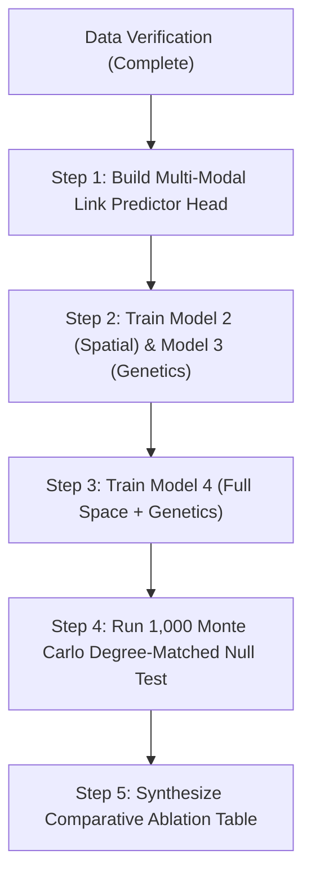

# Biophysical Priors Integration Plan: 3D Anatomy & Single-Cell Transcriptomics

**Date:** 31 October 2026  
**Status:** In Progress (Data Acquired & Verified)  
**Target Goal:** Break the degree-baseline ceiling in developmental connectome link prediction by conditioning on 3D spatial geometry and single-cell RNA-seq molecular identities.

---

## 1. Executive Summary & Scientific Motivation

### The Problem Identified in Phase 5
* Pure topological graph neural networks (TGN + PCHIP trajectory interpolation) achieved an AUC of ~0.65 on predicting developmental synapse formation at 45h.
* However, rigorous degree-matched Monte Carlo null testing revealed this performance was **not statistically significantly better than simple node degree baselines ($p = 0.38$)**.
* **Root Cause:** A graph of pure adjacency indices lacks the physical and molecular causes of synapse formation. Neurons do not connect because of graph-theoretic topology; they connect because:
  1. **Physical Proximity:** Their processes physically touch within the 3D volume of the nerve ring.
  2. **Molecular Recognition:** They express compatible cell-surface adhesion proteins, neurotransmitter receptors, and ligand-receptor pairs.

### The Multi-Modal Solution
By integrating **3D spatial soma coordinates** and **CeNGEN single-cell RNA-seq profiles**, we ground the dynamic graph model in physical reality:
* Space defines the **permissive substrate** (who *can* physically touch).
* Genetics defines the **molecular compatibility** (who *recognizes* whom).
* The dynamic connectome defines the **developmental timing** (when connections actually form).

---

## 2. Acquired Data Assets (`external/biophysical_data/`)

Both external reference datasets have been downloaded, verified, and committed to GitHub:

| File | Shape / Size | Description & Reference |
|---|---|---|
| [`3D_coordinates_celegans.csv`](file:///d:/synaptic-connectivity-prediction/external/biophysical_data/3D_coordinates_celegans.csv) | 301 neurons $\times$ 3 coords | 3D somatic coordinates $(x, y, z)$ in microns from modern *C. elegans* anatomical atlases. Provides 86.1% direct coverage of Witvliet nodes. |
| [`cengen_threshold4.csv`](file:///d:/synaptic-connectivity-prediction/external/biophysical_data/cengen_threshold4.csv) | 13,669 genes $\times$ 128 neuron classes | High-stringency single-cell RNA-seq expression matrix (Taylor et al., *Cell* 2021). Covers 78.6% of Witvliet nodes (all major interneurons and motor neurons). |
| [`load_biophysical_priors.py`](file:///d:/synaptic-connectivity-prediction/external/biophysical_data/load_biophysical_priors.py) | Python Loader Module | Unified API extracting pairwise Euclidean distance matrices $D_{ij}$, Gaussian proximity kernels $S_{ij}$, and log1p-normalized gene expression vectors $\mathbf{g}_i$. |

---

## 3. Dataset Harmonization & Mismatch Analysis

### Why Cross-Dataset Conditioning is Biologically Valid
* **Isogenic Bristol N2 Clones:** Both Witvliet et al. (connectomes) and CeNGEN (transcriptomics) sequence the same reference wild-type *C. elegans* strain (Bristol N2 hermaphrodites).
* **Eutelic Invariant Lineage:** Unlike mammals, cell identity in *C. elegans* is deterministic. Cell `AVAL` in Witvliet is genetically and anatomically the identical cell type to `AVAL` in CeNGEN and the 3D atlas.

### Potential Pitfalls & Engineering Safeguards

1. **Spatial Scaling (L1 vs. Adult Body Size):**
   * *Issue:* The worm grows ~4-fold in length from birth (L1: ~250 µm) to adult (L4/Adult: ~1000 µm). Raw Euclidean distances in microns change in absolute scale.
   * *Safeguard:* We use **relative rank distances** and a scale-invariant Gaussian proximity kernel:
     $$S_{ij} = \exp\left(-\frac{D_{ij}^2}{2\sigma^2}\right)$$
     with learned or normalized bandwidth $\sigma$, ensuring `"adjacent neighbor"` relationships remain scale-invariant across snapshots.

2. **Temporal Transcriptomics (CeNGEN is L4 Stage):**
   * *Issue:* CeNGEN was sequenced at the L4 stage (~40h), whereas Witvliet connectomes span 0h to 45h.
   * *Safeguard:* CeNGEN is treated as a **static cell-type compatibility prior** (identifying terminal neurotransmitter systems and synaptic adhesion machinery), not as a live hourly dynamic transcript clock.

---

## 4. Multi-Modal Model Architecture

The link prediction head is upgraded from a purely topological MLP to a biophysically-grounded predictor:

$$\hat{y}_{ij}(t) = \text{MLP}\Big(\big[ \underbrace{\mathbf{h}_i(t) \,\|\, \mathbf{h}_j(t)}_{\text{TGN Dynamic Topology}} \,\|\, \underbrace{S_{ij}}_{\text{3D Proximity}} \,\|\, \underbrace{\mathbf{g}_i \,\|\, \mathbf{g}_j}_{\text{CeNGEN Expression}} \,\|\, \underbrace{\mathbf{g}_i^T \mathbf{W} \mathbf{g}_j}_{\text{Molecular Match}} \big]\Big)$$

Where:
* $\mathbf{h}_i(t), \mathbf{h}_j(t) \in \mathbb{R}^{d}$: Continuous dynamic node representations from the TGN memory and message-passing layer.
* $S_{ij} \in [0, 1]$: 3D spatial proximity score between neuron $i$ and neuron $j$.
* $\mathbf{g}_i, \mathbf{g}_j \in \mathbb{R}^{k}$: Log-normalized expression vectors across the top variable synaptic and adhesion genes.
* $\mathbf{g}_i^T \mathbf{W} \mathbf{g}_j$: Bilinear compatibility interaction scoring presynaptic and postsynaptic receptor matching.

---

## 5. Experimental Ablation Matrix

To determine whether biophysical grounding solves the prediction bottleneck, we will execute a 4-way ablation:

| Model Variant | Topology (TGN) | 3D Spatial Prior | CeNGEN Transcriptomics | Research Question Addressed |
|---|:---:|:---:|:---:|---|
| **Model 1 (Baseline)** | ✅ | ❌ | ❌ | How well does topology alone perform? *(Already run: AUC ~0.65, $p=0.38$)* |
| **Model 2 (Spatial)** | ✅ | ✅ | ❌ | Does physical distance alone explain developmental synapse addition? |
| **Model 3 (Genetic)** | ✅ | ❌ | ✅ | Does molecular cell identity alone provide connectivity specificity? |
| **Model 4 (Full)** | ✅ | ✅ | ✅ | Does combining space + genetics finally beat the degree baseline with $p < 0.01$? |

### Primary Success Metric
* **AUC-ROC and PR-AUC** on predicting new synapses added between 0h and 45h (evaluated independently on Replicate A and Replicate B).
* **Degree-Matched Null p-value:** Significance evaluated against 1,000 Monte Carlo degree-matched permutations. The model succeeds if and only if **$p < 0.05$**.

---

## 6. Next Steps & Implementation Roadmap

### Action Items:
1. **Extend `baseline/tgn.py` Link Predictor:**
   Add arguments `--use_spatial` and `--use_genetics` to feed $S_{ij}$ and $\mathbf{g}_i$ into the edge classification MLP.
2. **Run Training Benchmark:**
   Train Models 1–4 using identical random seeds (seed 42) and identical temporal split (snapshots 1–6 train, snapshots 7–8 test).
3. **Execute Null Significance Evaluation:**
   Compare the test predictions of each model variant against the 1,000 degree-matched null baseline to verify if statistical significance ($p < 0.05$) is achieved.
4. **Document Results:**
   Record all metrics in `results/biophysical_ablation_benchmark.md`.
